<div align="center">

# LectureCraft

### A source-first study workspace that connects every slide to the moment it was taught, the questions that test it, and the concepts behind it.

Local-first · Read-only on your course material · Every link says where it came from


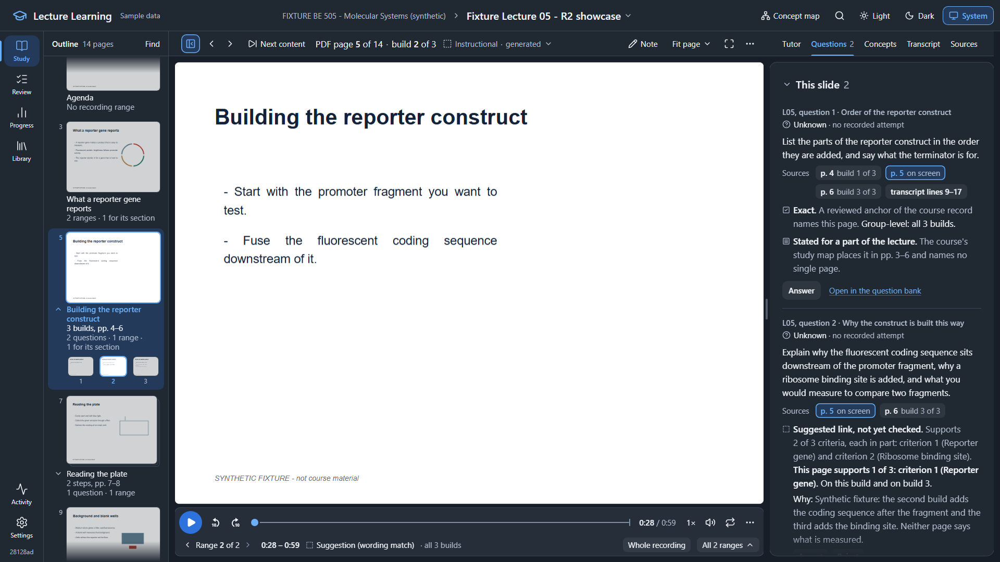

<sub>Every screenshot in this README shows the built-in synthetic sample course. No real course material is in this repository.</sub>

</div>

---

## The problem

A semester of lectures leaves a student with four disconnected piles: slide decks, hours of recordings, a question bank,
and a list of concepts to master. The real questions while studying cut across all four:

- *Where in the 90-minute recording did the professor explain **this** slide?*
- *Which practice questions actually test what is on **this** slide?*
- *Which concepts does this lecture cover, and what evidence do I have that I can do them unaided?*

LectureCraft answers them in one workspace, and it is strict about one thing most study tools are not:
**it never presents a guess as a fact.**

## What it does

| | |
|---|---|
| **Slide ↔ recording** | Every page of a deck shows the stretches of the recording where it is discussed. Pressing a range seeks the original media and stops at its end. Pages without a range say *why* (seven distinct states, each with its stated reason) instead of showing an empty player. |
| **Question ↔ slide** | Questions appear on the slides that support them, split into *This slide*, *Related concepts* and *All lecture questions*, each link labelled **Exact**, **Stated** or **Suggested** with the criteria it supports. |
| **Concept maps** | A keyboard-usable outline and a drawn graph of topics → concepts → skills → questions, scoped to the course, a lecture, or the slide on screen. Each node opens its sources, its questions and its evidence. |
| **Honest evidence** | Five evidence states (*unknown*, *not applicable*, *not separately observed*, *assisted*, *independent*) come straight from recorded attempts. There is no mastery percentage and no invented score. |
| **Offline transcription** | Recordings are transcribed on the local CPU in resumable, checkpointed chunks under a persisted time allowance. No audio leaves the machine and no API is billed. |
| **Light / Dark / System** | One token-driven design system, a resizable three-zone workspace on desktop, one focused pane at a time on tablets and phones. |

<table>
<tr>
<td width="50%">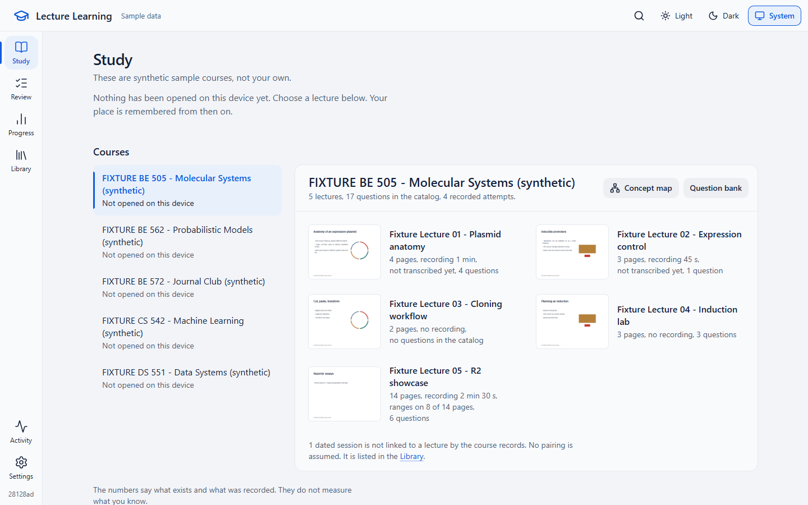<br><sub><b>Study home.</b> Courses, a Resume line, and lectures with real first-page thumbnails and plain facts.</sub></td>
<td width="50%">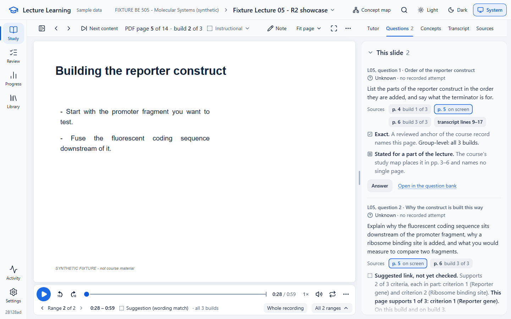<br><sub><b>Lecture workspace.</b> The slide is the largest object; one transport sits directly under it.</sub></td>
</tr>
<tr>
<td width="50%">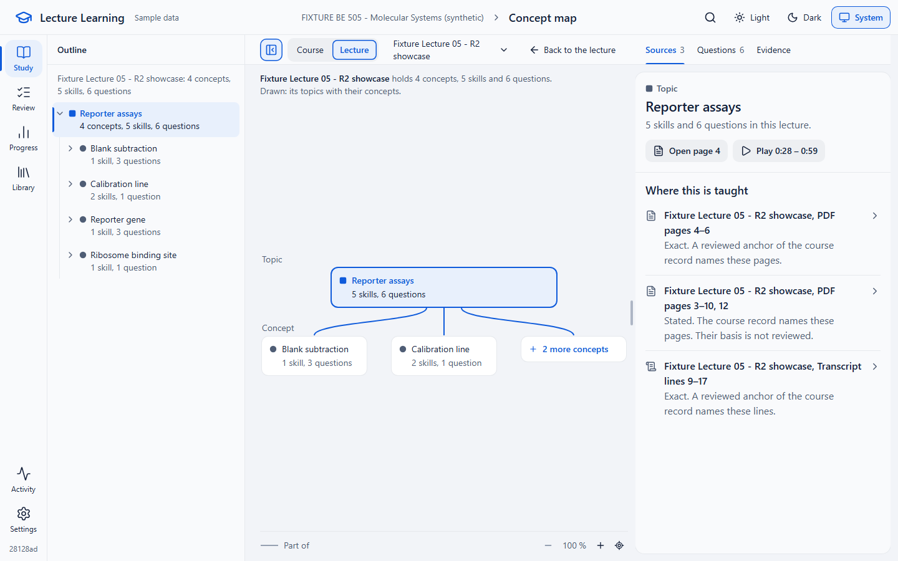<br><sub><b>Concept map.</b> A lecture's topics and concepts, with sources for the selected node.</sub></td>
<td width="50%">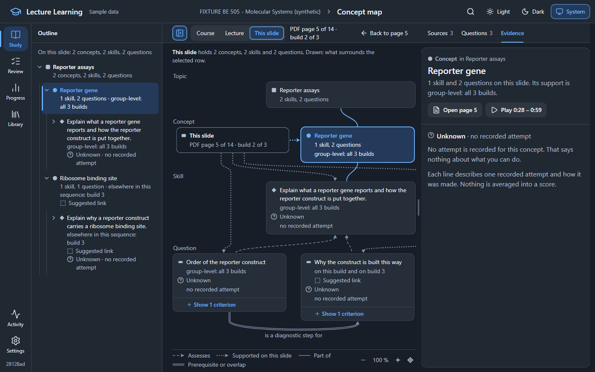<br><sub><b>Scoped to one slide.</b> What this slide supports, which questions assess it, and the recorded evidence.</sub></td>
</tr>
<tr>
<td width="50%">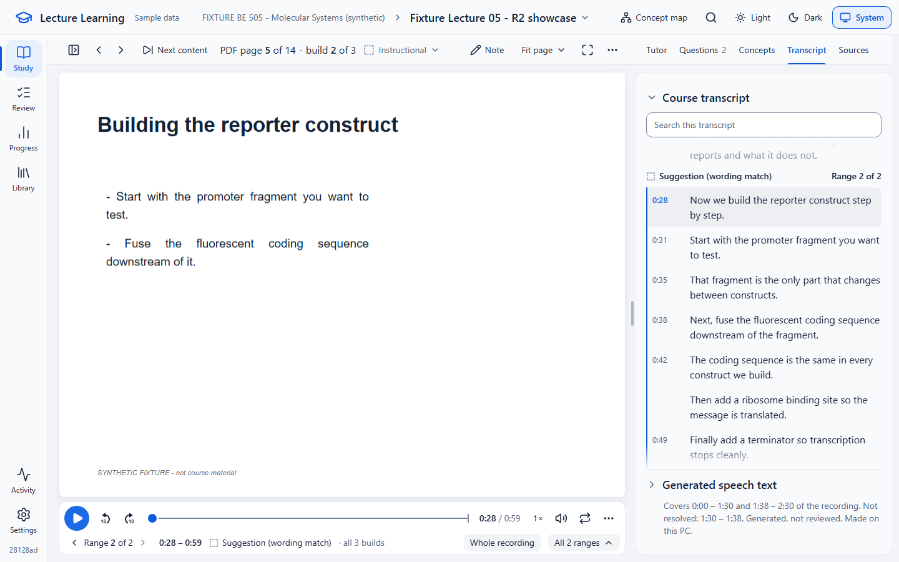<br><sub><b>Transcript.</b> The course's own transcript, timed where alignment succeeded.</sub></td>
<td width="50%">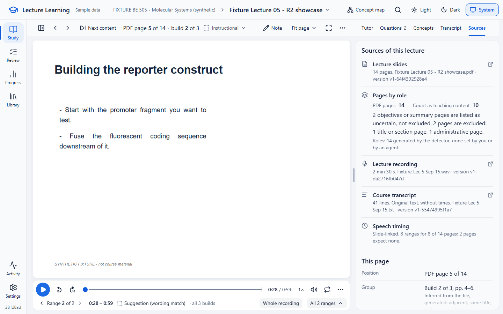<br><sub><b>Sources.</b> Every file with its version, plus pages by role with two honest denominators.</sub></td>
</tr>
</table>

<div align="center">
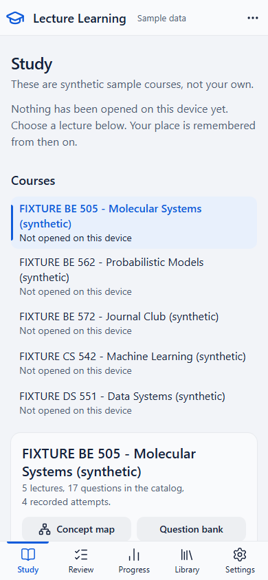
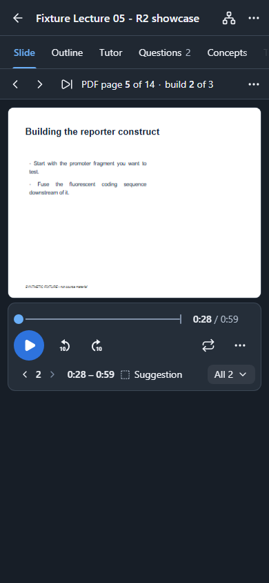
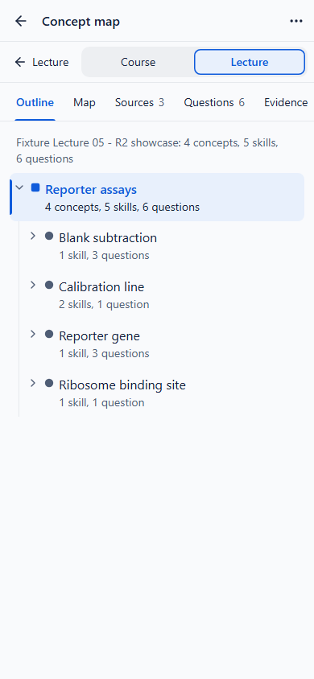
<br><sub>The same workspace at 390 px: one pane at a time, a docked player, nothing truncated.</sub>
</div>

## Engineering highlights

**Provenance is a first-class data type.** Every slide range carries three *separate* qualities (acoustic, association,
group mapping) and every question link carries its origin (course record, course study map, or agent suggestion) and its
review state. The UI words them differently, the API never merges them into one score, and a test fails if any suggestion
is ever worded as "aligned" or "verified".

**One versioned source map per deck.** PDFs are mapped by physical page, then grouped into logical slides: incremental
builds, animation steps and repeated copies are detected from several signals and labelled like *"PDF page 5 of 14 · build
2 of 3"*. Page roles (instructional, structural, administrative…) give two denominators that always add up. Learner
corrections are immutable revisions with history, never edits in place.

**Read-only by construction.** The app reads the owner's course folders and never writes to them. Everything derived
(source maps, generated speech text, timing links, suggestions, decisions) lives in a private, rebuildable state
directory. A boundary test enumerates every state-changing route.

**A measured, honest alignment pipeline.** Offline speech recognition → anchored token alignment onto the course's own
transcript → a sequence model over logical slides, benchmarked side by side with a plain lexical baseline. The benchmark
showed the sequence model is *not* better than the baseline on the labels available, so the product says exactly that on
every range and only shows a suggestion when the baseline agrees or the course's own pairing covers it. The selection rule
was fixed before the first real run and not tuned afterwards.

**Resumable, bounded background work.** Transcription runs in checkpointed chunks under a persisted wall-time allowance
that survives restarts, is never reset by a retry, and pauses safely at its ceiling.

**Tested like a product, not a demo.**

| Layer | What runs | Count |
|---|---|---:|
| Brain (Python) | `pytest`: contracts, projections, alignment, source maps, idempotency, restart and stale-input behaviour | 1,300 |
| Web units | `vitest`: label tables, layout rules, transport, question cards, concept-map model | 1,042 |
| Browser | Playwright: every UI flow on a desktop and a phone project, a ten-way viewport × theme sweep with axe accessibility scans, component stories | 494 |

One command, `python tools/ci.py`, runs every stage. The last full run passed with **zero retries**.

## Architecture

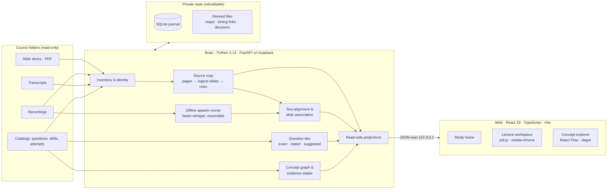

| | |
|---|---|
| **Backend** | Python 3.13, FastAPI, SQLAlchemy + Alembic (SQLite), JSON Schema contracts, pypdf, faster-whisper (offline, CPU) |
| **Frontend** | React 19, TypeScript, Vite, Tailwind 4 design tokens, Radix primitives, TanStack Query, react-router, pdf.js, Media Chrome, React Flow + dagre, react-resizable-panels |
| **Quality** | pytest, Vitest, Playwright (+ axe), Storybook, a declared-checks build board with per-task receipts |

## Run it locally

Requirements: Python 3.13 and Node 22. The `fixture` profile ships a complete synthetic course, so nothing else is needed.
(Transcribing your own recordings additionally needs `faster-whisper` in the same environment; the sample does not.)

```bash
python -m venv .venv
.venv/Scripts/pip install -r brain/requirements.lock -e brain    # Windows; use .venv/bin/pip elsewhere
cd web && npm ci && npm run build && cd ..
.venv/Scripts/python -m lecture_brain --profile fixture serve --port 8765
```

Open http://127.0.0.1:8765, pair the browser on the Connect page, and open *Fixture Lecture 05 – R2 showcase*: a deck with
builds, a recording with generated ranges, suggested question links and a concept map.

Run every check:

```bash
python tools/ci.py
```

## How it was built

LectureCraft is developed **specification-first and test-first**. The repository holds the product specification (64
stories, 32 UI flows, 12 workflows), a 38-task backlog with a build board that records a receipt for every task's declared
checks, and dated amendments whenever real use contradicted a green test.

The implementation was carried out with **AI coding agents (Claude Code) under my direction**: I set the requirements,
rejected a first visual design after using it, and required evidence instead of claims. In practice that meant
orchestrating parallel agents with exclusive file ownership, independent critics that reviewed the built interface in a
real browser, a second agent that checked every link the first one proposed, and auditors that verified each number in a
report against its evidence file. The prompts that drove each pass are kept verbatim in [`PROMPTS/`](PROMPTS/).

A few things that process surfaced, and that I think say more than a feature list:

- A passing test suite did not mean a usable product. The first build passed every check and still had no usable slide-to-recording
  ranges on screen. The requirements were reopened with 67 new on-screen checks.
- An independent audit of the final reports found a real defect (the concept map counted criteria on a slide that a
  suggested link placed on *other* slides). It was fixed test-first and the entire integrated run was repeated.
- The benchmark said the more sophisticated matching method was not better than the simple one. The product now tells the
  user so, rather than hiding it.

## What it deliberately does not claim

- Slide ranges and suggested question links are **suggestions**. They are labelled as such until a person confirms them.
- Nothing here measures learning outcomes, and the app shows no mastery score.
- It is a single-learner, local tool. It has no accounts, no hosting and no cloud dependency.

## Repository map

| Path | What is there |
|---|---|
| [`brain/`](brain/) | The local service: owner-file readers, source map, speech runner, alignment, question ties, concept graph, projections, API |
| [`web/`](web/) | The React app, its unit tests, Playwright flows, viewport sweep and stories |
| [`docs/`](docs/) | Product specification, feature packets with requirements and test plans, engineering contracts, decisions |
| [`contracts/`](contracts/), [`fixtures/`](fixtures/) | JSON Schemas and the synthetic contract fixtures |
| [`tools/`](tools/) | `ci.py` (all checks as one contract), the build board, baseline and contract checks |
| [`PROMPTS/`](PROMPTS/) | The instructions each development pass was run from |
| [`START_IMPLEMENTATION.md`](START_IMPLEMENTATION.md) | The original implementation brief |

---

<div align="center">
<sub>Built by <a href="https://github.com/Mahmoudimahyar">@Mahmoudimahyar</a></sub>
</div>
